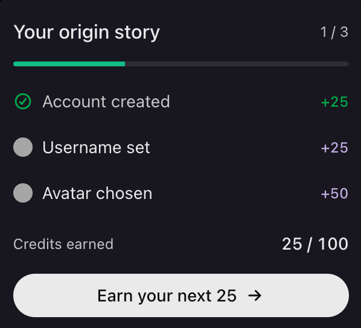

# Origin story card in the sidebar

The card sits in the lower left of the desktop sidebar, inside `.sidebar-view__footer`, directly above the account row (avatar, name, bell, credits). The account row stays where it is. The card does not replace it.

The footer is pinned to the bottom of `.sidebar-view__panel`. The roster scrolls behind it. The card is part of that pinned footer, so it stays on screen while channels scroll. Width follows the sidebar (220–460px) with the footer’s existing 8px side padding. The title and `1 / 3` share one line. The green bar, the three steps, the credits line, and the button stack under that. The button is full width.

Copy and amounts match the picture:

- Account created, +25, already done
- Username set, +25
- Avatar chosen, +50
- Credits earned, shown as a running total out of 100
- Button label is the next unpaid step: “Earn your next 25” or “Earn your next 50”

Pending amounts use the accent purple. The finished step uses a green check and a green bar segment. One segment fills per finished step.

Each unfinished step opens its modal. The button does that for the next unpaid step. A finished step is not a control. When all three steps are done and the credits are recorded, the card is removed and the footer is only the account row again.

On a phone the sidebar panel is hidden. The same card is not squeezed into the bottom nav. The account control shows the `1 / 3` mark, and opening account shows this card at the top of that sheet. The mark stays until the card is gone.
