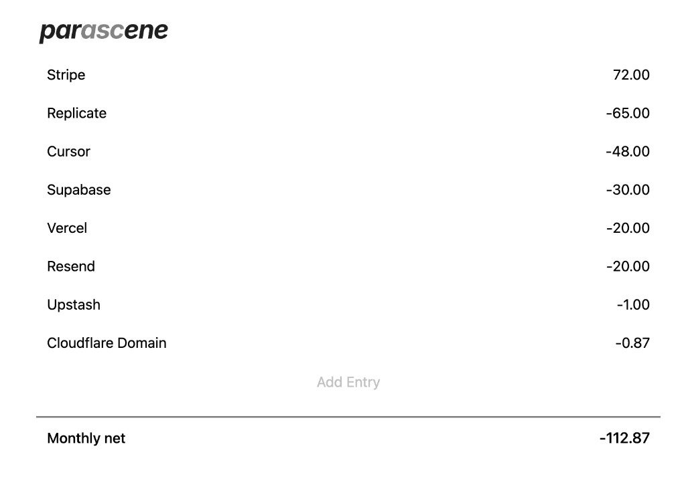
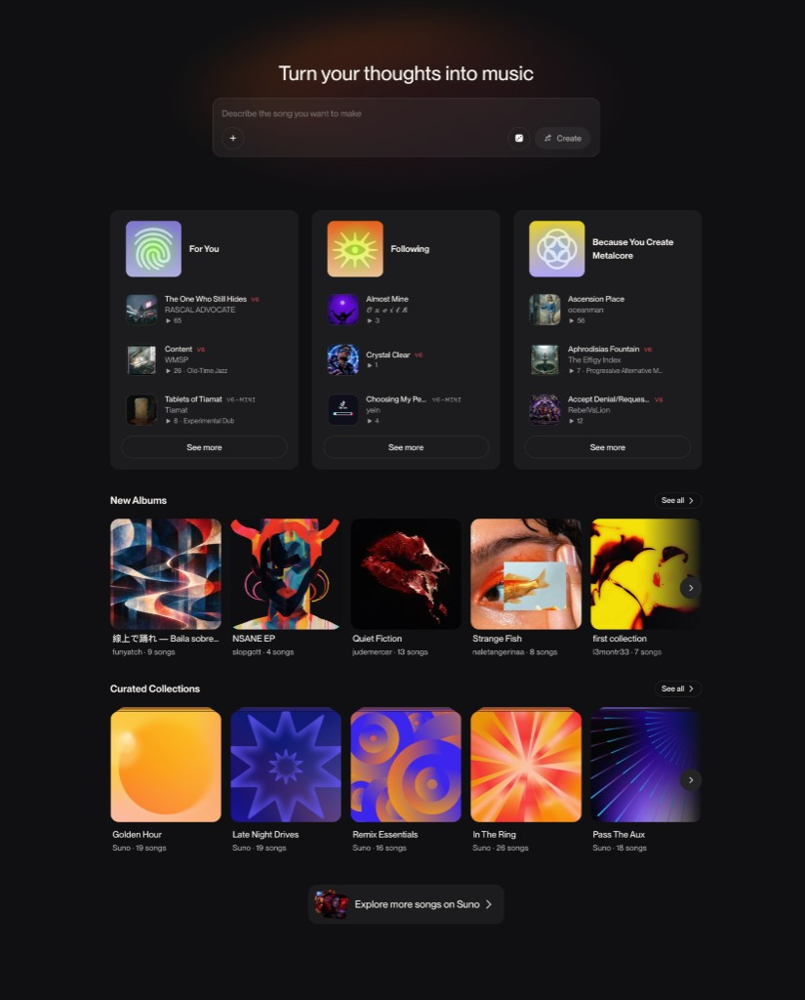
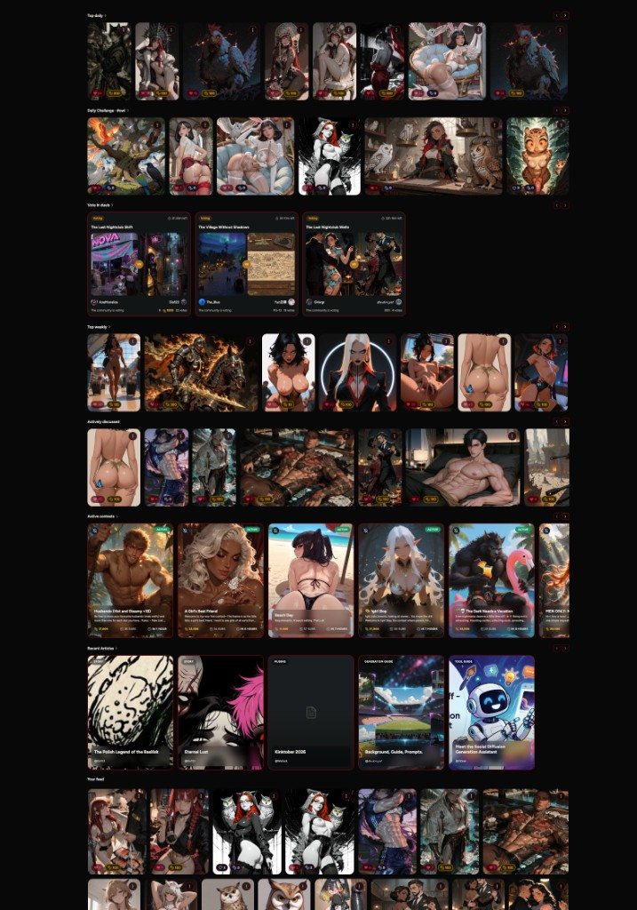
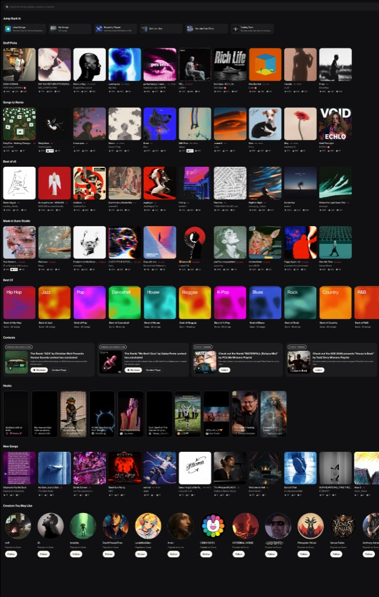
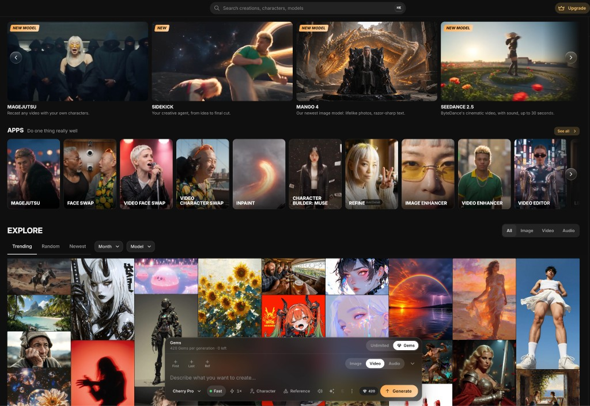
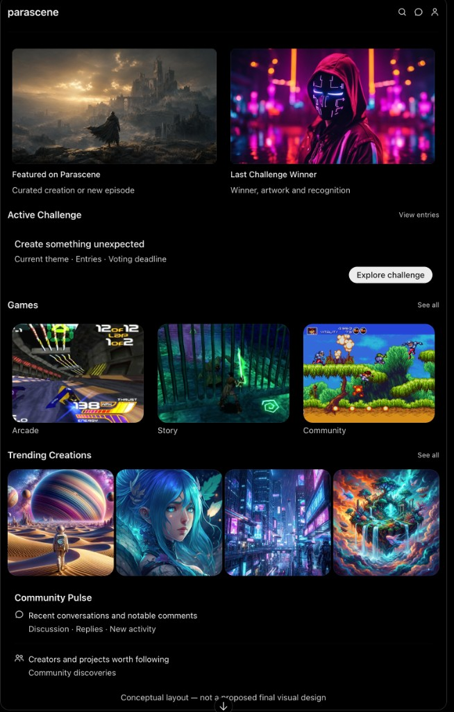

# Plan: Strategy shift

https://chatgpt.com/share/6afa9b87-2764-83ea-9aa1-d7ea8c466b34

That thread is the source. Visuals from it are in `_docs/strategy-shift/`.

Pulse here is the desktop home. It is a different thing from the visit-pulse analytics reports.

## Point

Parascene stays alive cheaply as a home. Growth comes from content made for other platforms.

Build Parascene to survive without growth. Build content and IP to create growth.

Fine if it were only you and your wife. It would still be a place to share current AI tools with people who want them. The annoyance to avoid is a painful process to add a model, or to keep challenges, communication, and updates running.

A small committed group can carry continuity while casual people come and go. Casual use is fine when it does not create cost or demand daily attention.

## Not this

- Not a full Discord. Chat is not the product.
- Not a full Suno. No audio studio. Audio is one capability.
- Not a full image product. Images are one capability.
- Not a full Patreon. They take money and tack social on.
- Not four products bundled, and not a startup that must grow to justify itself.

Creation, publishing, discovery, interaction, and money are capabilities in one place. None of them has to be the whole product. Work made elsewhere can be brought here with its audience.

Test for a new feature: does it help people create, experience, or participate in something together, or is it a specialist app reproduced?

## Two businesses

Content and IP get the primary attention. Parascene is the destination and the tools. They reinforce each other. They do not get equal time.

- Acquire attention on existing platforms. Micro-dramas, thirst traps, educational, documentary, whatever actually works there.
- Convert with a reason to come here. Later episodes, early releases, bonus scenes, the people making it.
- Keep them with Pulse, challenges, and participation.

A thirst trap can get views and leave nothing. A character or series people recognize is the asset. Own productions can invite participation (another ending, a character, a piece of the world) and that activity shows up on Pulse.

Watch the first episodes anywhere. Continue on Parascene. Do not paywall or registration-wall the start. Registration is for following, commenting, participating, or unlocking more. Getting the relationship matters more than the first subscription.

Measure two things apart: what earns attention, and what turns that attention into someone who comes back here.

Views on other platforms can become their own job and never grow Parascene. That is the risk to watch.

## Who shows up

Same place, different use. Do not require everyone to generate.

- Viewer. Episodes and other watching.
- Fan. Characters, series, creators.
- Casual creator. Images, experiments, challenges.
- Active creator. Video, audio, work that continues.
- IP builder. Stories and characters that accumulate.

One person can move between these. One social system, not five apps.

Pulse follows what that person cares about. Challenges allow watching, voting, a casual entry, or a serious one. Creation stays easy to reach and does not run the visit of someone who only came to watch.

People who arrive with no interest in AI generation are the larger audience. Give each visitor a reason to return whether or not they ever generate.

A creator who brings an audience is worth more than a pile of isolated generations.

## Money

Sheet above, about Nov 2026. Stripe 72. Replicate −65. Cursor −48. Supabase −30. Vercel −20. Resend −20. Upstash −1. Cloudflare domain −0.87. Net −112.87.

- Vercel to AWS VPS, expected about $12 / month, about $8 saved
- Replicate is about 35% of spend
- Cursor is development, not platform operations

Replicate stays. It is overflow when Blue is busy, not the normal path. The $65 should fall as more runs land on Blue. It will not go to zero.

If VPS is done, Replicate is no longer a baseline, and Cursor is treated as development, operating cash is roughly even before any new subscribers. At a $12 subscription, about four more paying people covers the remaining gap. The sheet does not include Blue power, hardware, or payment fees.

Order:

- Finish the VPS move.
- Blue when it has room. Replicate when Blue is full, down, or cannot run that model. Queue on Blue when the wait is acceptable.
- Do not send an expensive generation to Replicate just to skip a short queue unless the request or the plan pays for it.
- Track share of generations on Blue, Replicate overflow cost, and average queue wait.

Break-even is modest. Do not chase more models to get there.

## Product shape

One activity system. Pulse is the discovery experience. Mobile is another presentation of it. Desktop does not get a lesser copy of the mobile feed.

- Desktop home is Pulse. Desktop only for this pass.
- Mobile stays a scroll of the same activity, adapted. Same selection, different layout.
- Explore is the dense library behind "see all." Pulse stays the front page.

The feed shows what people made. Pulse shows what is happening. Challenges give something to do.

A feed ranks by recency and buries a game, a series, or last week's winner. Pulse can keep those.

Three lifetimes on the page:

- Persistent. Games, series, projects. Age does not remove them.
- Timely. Active challenge, new episode, announcement.
- Activity. New creations, comments, scores, trending. This is what makes a persistent thing visible again.

A comment lasts hours. A challenge winner stays until the next one. A game or a series stays.

Pulse is an overview of activity that already exists. It does not need its own posts or someone curating it. Sections fill themselves. Closing a challenge promotes the winner and archives the previous one.

Small community: show meaningful developments and open opportunities. Do not show a deserted chronological stream. Do not let one person's burst, or one popular challenge, fill the page. Entries can appear as items. The challenge also appears as a whole.

## Pulse, desktop home

Editorial homepage. Not an infinite scroll. Not a dashboard of tools.

Items for this page:

- drive challenges
- longform / involved content
- legacy content
- new users
- leaderboard
- rewards
- engagement

Suno home is the density. A few short groups, then one way into more. Section names come from the next image, because Suno’s are songs and albums.

Section ideas come from this image. Top daily, daily challenge, voting, top weekly, actively discussed, active contests, recent articles, your feed.

"See all" opens the dense explore page. Contests, hooks, creators, many rows. That is not the home.

Creation can sit near discovery. This page does that, and it leads with models and tools. Skip that chrome.

Sketch of the section order only. The image says it is not the visual design.

Sections, mixed layouts, not every row a carousel:

- Featured. A creation or a new episode.
- Last challenge winner. Piece, person, challenge, link to results. Stays until the next winner.
- Active challenge. Theme, deadline, count, a way in.
- Games. Playable, including ones that would have fallen off a feed. See all opens the library. A new score is activity. The game itself stays.
- Series. Ongoing IP and episodes.
- Creations. Recent, popular, followed. See all opens explore.
- Social. Comments and conversation worth seeing.
- Hall of fame. Past winners and milestones, smaller than the current winner.

Recent, popular, and personally relevant are different jobs. One of them should not crowd the others out.

Not customizable. Enough ranking to stay interesting. No settings page for the home.

Desktop only for now. Lay it out so the same sections can later stack into the mobile scroll. Do not build a second feed to throw away.

Done when a desktop visit lands here, a game and the last winner are still on the page after newer posts, and each section can open a fuller list.

Load later. The rows will change, so do not build the store until they settle. The store should not care which rows exist.

Same idea as the feed catalog. A snapshot is already waiting. Opening the page reads it. It does not build it.

- Browser keeps the last payload and shows it at once. The next snapshot loads behind that and replaces it.
- Actions write a live pool as they happen. Publish, comment, like, challenge enter or close, new account, new article. The write records the event. It does not rebuild the page.
- About every 15 minutes that pool is reconciled into the snapshot the client reads. Caps, dedupe, and one voice not filling a row happen there.
- Redis holds the pool and the snapshot. Same kind of store the feed catalog already uses. One shared read. No section queries on the request.
- Named slots. Adding or dropping a row changes what reconcile fills, not the path.
- A personal row stays out of the shared snapshot. NSFW blur is applied at read, as the feed already does for the viewer.
- If the store misses, serve the last snapshot. Do not assemble the page from the database for that request.

## Challenges

- more automated admin
- flair for winners
- notify results, @everyone

Public entries are a condition of entering, said up front. Not a silent change to something already private.

An entry is a property of the creation, not a second place to publish. It shows up in the activity that fills Pulse and the mobile scroll, marked as a challenge entry. That is how people find the challenge.

Scheduling, entries, voting, results, and the handoff to the next challenge run without administration. The winner slot on Pulse updates when a challenge closes.

Done when an entry appears without a separate publish step, and closing a challenge moves the winner without a manual post.

## Creation

No server choice in the UI. The person says what they want. The app decides where it runs.

Keep these separate:

- Capability. What they are doing.
- Model. What does it.
- Provider. Blue, Replicate, or a later backend. The same model can have more than one provider. Routing is capacity and cost.

Adding a model is configuration: capabilities, inputs, defaults, constraints, price, which providers can run it. No new screen and no special workflow unless the capability is actually new. Time to expose a new model is the internal metric.

Complexity stays available. It is not required. Manual control stays.

## LLM

In the create flow, not a general chat product. It calls the same creation system as the UI.

- Rewrite a prompt in place.
- Suggest which model fits.
- Iterate on the last result ("keep this, change the light").
- Chain a step ("animate this, then add dialogue").
- Use the last generation's settings without the person retyping them.

Prompt help is enough to start. Later it can help run a challenge or publish. Budget it so it does not become the next Replicate.

Done when a prompt can be rewritten and sent without leaving Parascene.

## Maintenance test

Normal operation needs no admin. Leave for a month, come back, add a model, publish, enter a challenge, and talk, without repairing the place first.

Abuse, outages, and real infrastructure work still happen. They are exceptions.

For any new feature: does this add attention Parascene demands, or remove it?

## Order

1. Finish VPS. Route Blue first, Replicate as overflow. Generation no longer asks which server. Overflow cost is visible.
2. Desktop Pulse home, sections above, filled from existing activity. Mobile scroll stays as it is for this pass.
3. Challenge entries public and in that activity. Winner slot updates on close.
4. Model add becomes configuration. Capability, model, and provider stay separate.
5. LLM inside creation, prompt and iteration only, on a budget.
6. Later, and not part of building Pulse: free early episodes off-platform, continuation here, registration only past watching.

## Out of this plan

- Customizable Pulse
- A separate experience per kind of visitor
- A world-building system
- An audio studio, a generic chat client, or a model marketplace
- Charging for the first episodes
